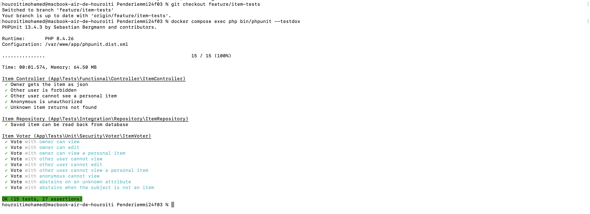
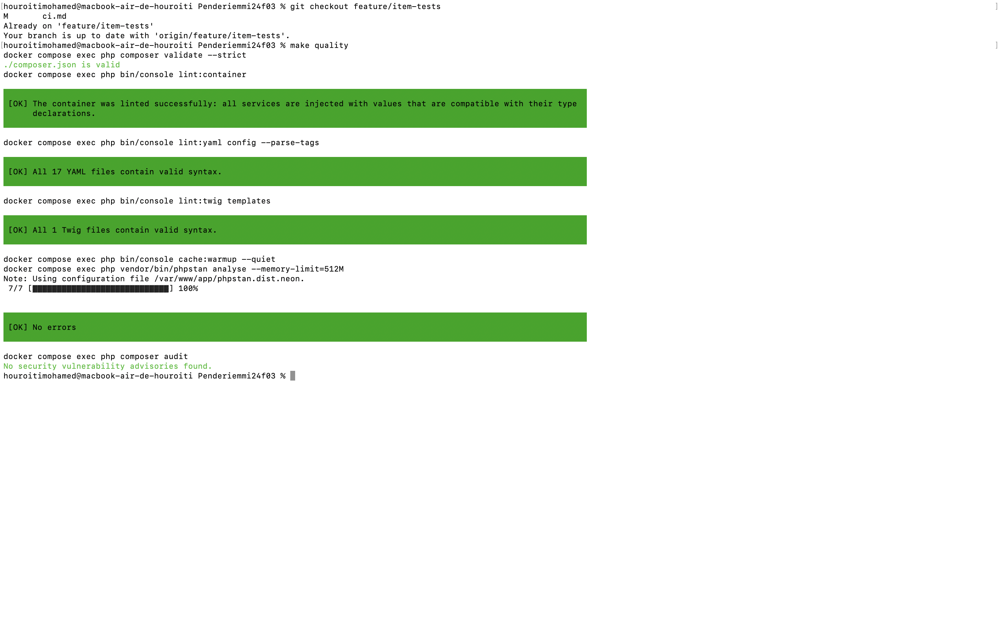

# Intégration continue — preuves d'exécution

Auteur : Mohamed Houroiti

Ce document rassemble les preuves que les tests et les contrôles qualité passent : l'intégration continue sur GitHub, et les captures de `make test` et `make quality` au vert (rangées dans `docs/ci/`).

## Intégration continue (GitHub Actions)

Depuis la séance 17, `.github/workflows/ci.yml` lance automatiquement, **à chaque push et à chaque pull request** :

1. l'installation des dépendances (PHP 8.4, mêmes extensions que l'image Docker) ;
2. `composer validate --strict` ;
3. les linters Symfony (conteneur, YAML, Twig) ;
4. PHPStan niveau 6 ;
5. `composer audit` (vulnérabilités connues) ;
6. la création d'une base PostgreSQL de test et ses migrations ;
7. PHPUnit.

Une pull request dont le pipeline est rouge n'est pas mergée. L'historique des exécutions est visible dans l'onglet **Actions** du dépôt.

Dernière exécution sur `develop` :

- Date : 16 novembre 2026
- Commit : `18b34d5`
- Résultat : **succès** (toutes les étapes vertes)
- Lien : https://github.com/houroiti/Penderiemmi24f03/actions/runs/43779137850

## Commandes en local

```bash
make up        # démarre les conteneurs
make test-db   # (re)crée la base de test
make test      # lance PHPUnit
make quality   # validate, lint, PHPStan niveau 6, composer audit
```

Résultat attendu : `OK (81 tests, 211 assertions)` pour `make test`, et aucune erreur pour `make quality`. Le détail de ce que vérifient ces tests est dans `coverage.md`.

Pour une capture plus lisible, la commande suivante affiche le nom de chaque test :

```bash
docker compose exec php bin/phpunit --testdox
```

## Captures

### Premiers tests : `ItemVoter`, `ItemRepository` et `GET /api/items/{id}`

- Date : 18 octobre 2026
- Branche : `feature/item-tests`
- Commit : `f72e815`
- Résultat : OK (15 tests, 27 assertions)



### Contrôles qualité

- Date : 18 octobre 2026
- Branche : `feature/item-tests`
- Commit : `f72e815`
- Résultat : validate, lint, PHPStan niveau 6 (0 erreur) et composer audit (aucune vulnérabilité) au vert



Ces captures datent de la mise en place des tests. La campagne actuelle (81 tests) tourne à chaque push dans la CI, dont l'exécution fait foi.
