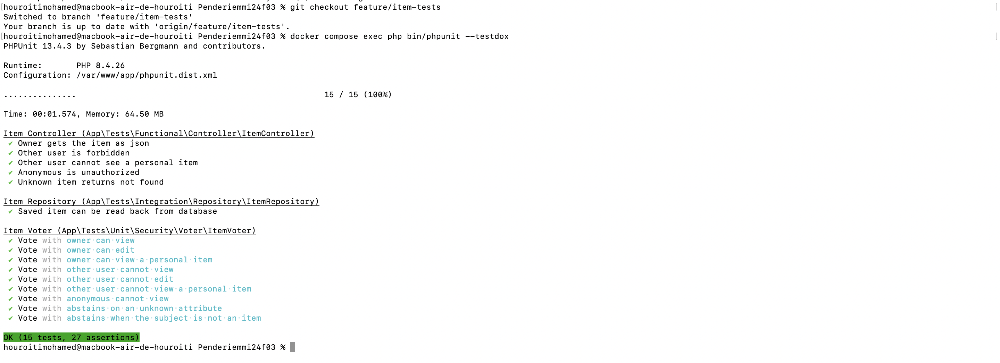
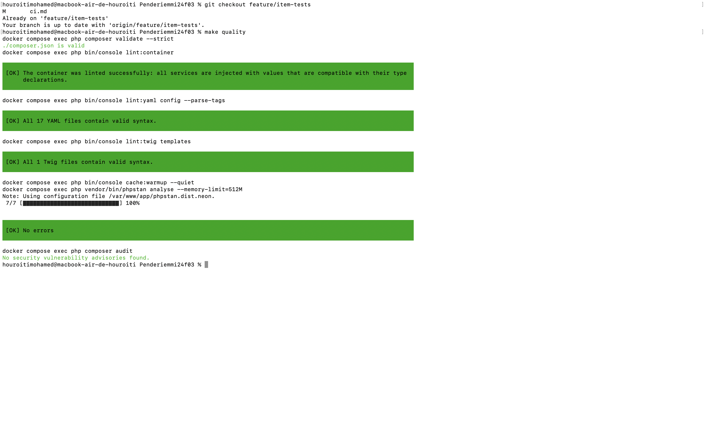

# Intégration continue — preuves d'exécution

Auteur : Mohamed Houroiti

Ce document rassemble les captures de `make test` (et `make quality`) au vert, avec la date et le commit concernés. Les images sont rangées dans `docs/ci/`.

## Commandes

```bash
make up        # démarre les conteneurs
make test-db   # (re)crée la base de test
make test      # lance PHPUnit
make quality   # validate, lint, PHPStan niveau 6, composer audit
```

Résultat attendu : `OK (15 tests, 27 assertions)` pour `make test`, et aucune erreur pour `make quality`.

Pour une capture plus lisible, la commande suivante affiche le nom de chaque test :

```bash
docker compose exec php bin/phpunit --testdox
```

## Captures

### Tests de `ItemVoter`, `ItemRepository` et `GET /api/items/{id}`

- Date : 18 octobre 2026
- Branche : `feature/item-tests`
- Commit : `f72e815`
- Résultat : OK (15 tests, 27 assertions)



### Contrôles qualité

- Date : 18 octobre 2026
- Branche : `feature/item-tests`
- Commit : `f72e815`
- Résultat : validate, lint, PHPStan niveau 6 (0 erreur) et composer audit (aucune vulnérabilité) au vert

  

## Prochaine étape

Brancher `make quality` et `make test` dans une GitHub Action, lancée à chaque push et à chaque pull request (plan d'action de `audit.md`, séance 17). Les captures pourront alors être remplacées par le lien vers l'exécution GitHub.